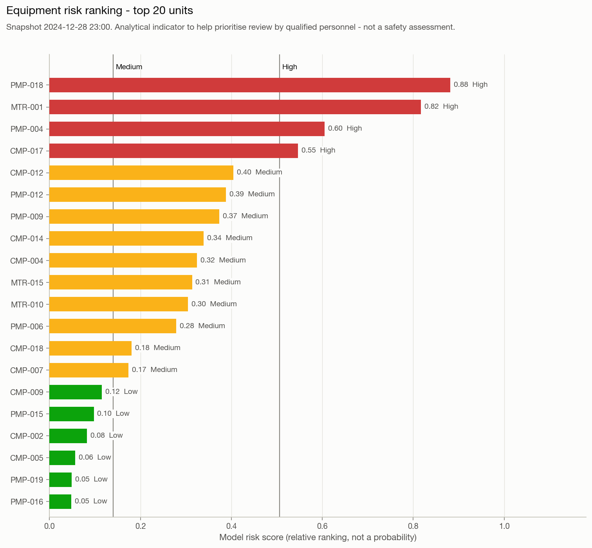
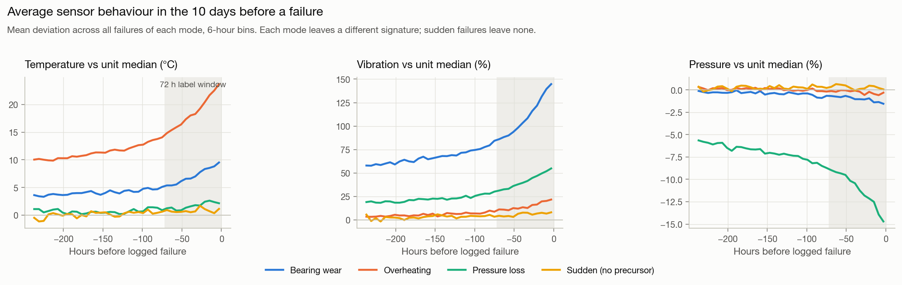
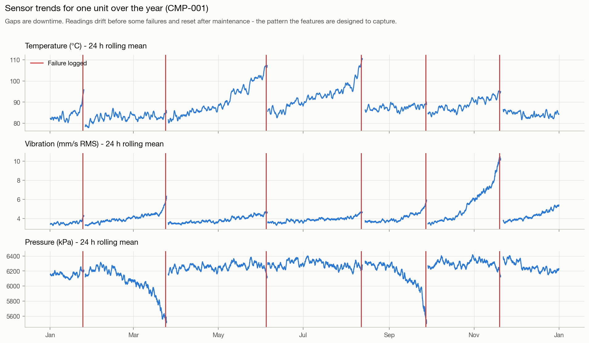
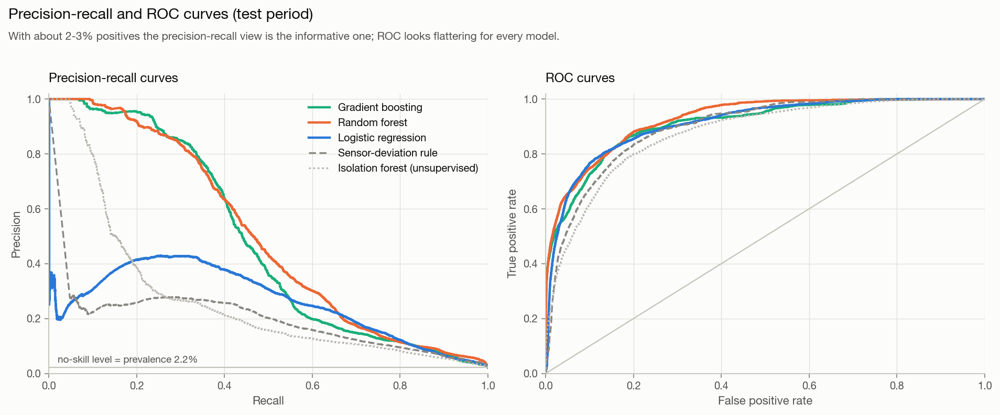
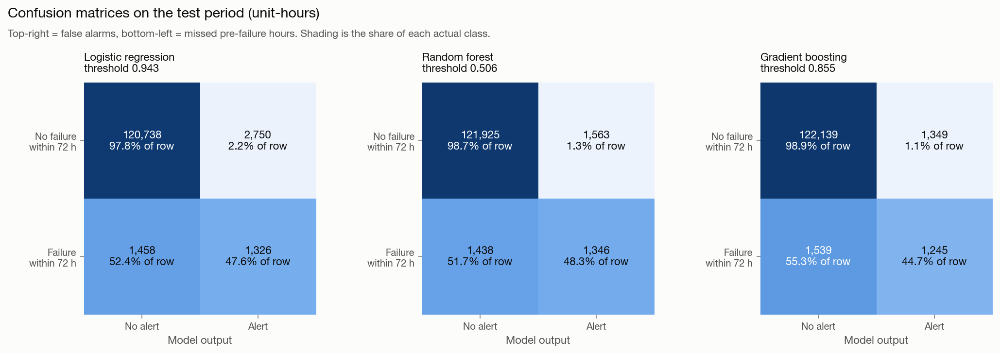
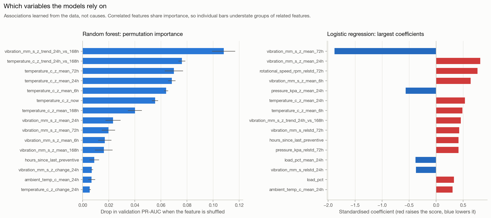
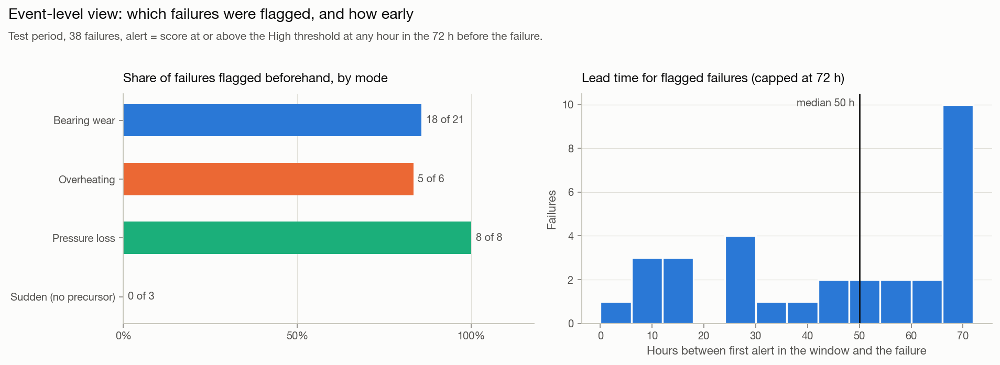
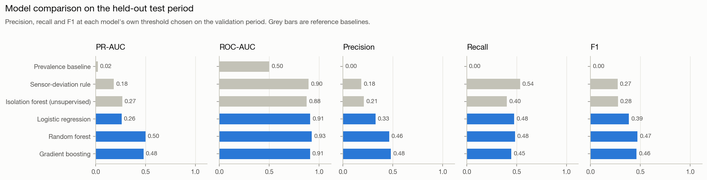
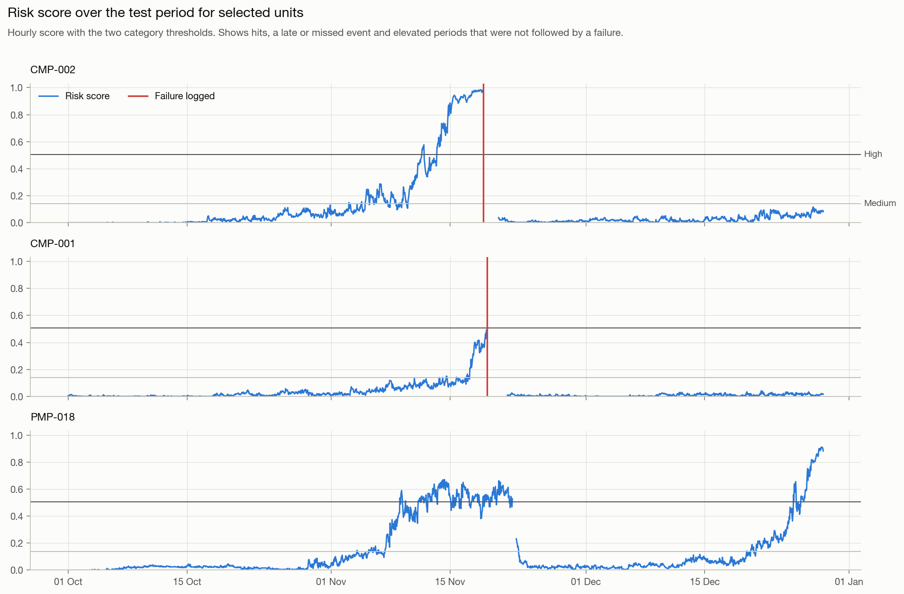

# Predictive Maintenance for Oil Field Equipment Using Machine Learning

An end-to-end data science project that turns equipment sensor data into a ranked,
evidence-backed list of pumps, motors and compressors that may deserve a closer look.

> **Read this first**
>
> * **The data is synthetic.** It is generated by a simulator in this repository. It does not come
>   from real equipment, a real site or any company's records, and none of the results are
>   evidence about real-world performance.
> * **This is a decision-support analysis.** The model does not determine whether equipment is
>   failing, does not declare anything unsafe and does not issue maintenance instructions. Its
>   output is an indicator for qualified personnel to review.



---

## Executive summary

| | |
|---|---|
| **Question** | Which units show sensor patterns associated with a failure in the next 72 hours? |
| **Data** | 60 simulated units (20 pumps, 20 motors, 20 compressors), one year of hourly readings (519,474 rows), 153 failures, maintenance log |
| **Class balance** | 2.2% of unit-hours are followed by a failure within 72 h (1 in 45) |
| **Approach** | Leakage-safe, unit-normalised rolling features → logistic regression, random forest, gradient boosting → chronological validation with purge gaps |
| **Primary model** | Random forest, chosen by walk-forward cross-validation |
| **Test result** | PR-AUC **0.50** (95% CI 0.41-0.62) against a no-skill level of 0.022; ROC-AUC 0.93 |
| **In maintenance terms** | 31 of 38 test-period failures had an alert in the preceding 72 h (median lead 50 h), at about 0.7 false-alert days per unit per month |
| **Honest caveat** | Fewer than half of the strongest flags (46%) were followed by a failure within 72 h. It is a prioritisation aid, not an alarm |
| **Replication** | On three freshly simulated fleets never used in development: PR-AUC 0.59-0.62 |

## Business problem

Oil and gas operations depend on rotating equipment. Unplanned failures bring downtime,
maintenance cost and operational disruption. Maintenance teams have more equipment than
inspection hours, so the practical question is **where to look first**.

This project builds an analytical system that reads equipment sensor data, identifies patterns
associated with elevated failure risk and ranks units for review - with the supporting sensor
evidence and a documented error rate - so that people can make better-informed prioritisation
decisions. See [`reports/business_analysis.md`](reports/business_analysis.md).

## Dataset

Four tables that mirror what a maintenance organisation typically holds:

| File | Rows | Content |
|---|---|---|
| `data/raw/telemetry.csv.gz` | 519,474 | Hourly temperature, vibration, pressure, rotational speed, load, ambient temperature, operating hours |
| `data/raw/equipment_registry.csv` | 60 | Equipment ID, type, area, rated power |
| `data/raw/maintenance_log.csv` | 292 | Preventive and corrective work orders with start and end times |
| `data/raw/failure_log.csv` | 156 (153 unique) | Failure time and failure mode |

Full column definitions: [`documentation/data_dictionary.md`](documentation/data_dictionary.md).

**Why synthetic?** Public predictive-maintenance datasets were reviewed (NASA C-MAPSS turbofan
data, the UCI AI4I 2020 dataset, Microsoft's Azure predictive-maintenance example data, bearing
run-to-failure data). None combines the equipment types, sensor channels, maintenance history and
failure labels this problem needs, and the two closest tabular options are synthetic themselves.
Reasoning and trade-offs: [`documentation/dataset_selection.md`](documentation/dataset_selection.md).

**How the simulator works.** Each unit has a hidden wear state that grows with running hours and
load, is partly reset by time-based preventive maintenance and fully reset after a failure.
Failures are drawn from a hazard that rises with wear, then take a random 24-144 hours to develop
while damage accelerates. Each wear cycle has a dominant mode (bearing wear, overheating, pressure
loss) that decides which sensors drift. About 7% of failures are sudden and leave no sensor trace.
The generator also injects realistic data-quality problems for the validation stage to find.

## Data limitations

* **Not real.** Results describe behaviour on a simulator, nothing more.
* **Simpler than reality.** Three clean degradation modes, instant sensor response, no sensor
  drift, no operating-mode changes, a tidy maintenance log.
* **Failures are far more frequent than in a real fleet** (about 2.5 per unit-year) so there are
  enough events to learn from. Real class imbalance would be much harsher.
* **Small event counts.** 38 failures in the test period; one failure moves event recall by 2.6
  points.
* **The modeller wrote the simulator**, so feature design was informed by how the data is made.

## Methodology

```
generate ─► validate & clean ─► condition-adjust ─► features + 72 h label ─► chronological split
                                                                                   │
        risk ranking ◄─ evaluate on test ◄─ thresholds on validation ◄─ walk-forward tuning
```

1. **Data validation.** Missing values, duplicates, data types, invalid readings, equipment-level
   inconsistencies, temporal coverage, label quality and class imbalance are measured first, then
   cleaned with documented decisions
   ([`reports/data_validation_report.md`](reports/data_validation_report.md)).
2. **Condition adjustment.** Each sensor's response to load and ambient temperature is fitted per
   unit on the training period and removed, so a hot day or heavy duty is not mistaken for
   degradation.
3. **Feature engineering (47 features).** Rolling means and standard deviations (6 h, 24 h, 72 h,
   7 d), short-versus-long trends, 24-hour changes, all expressed in each unit's own historical
   spread; hours since last maintenance; failures in the trailing 90 days; equipment type.
4. **Leakage prevention.** Time-based backward-looking windows, exact-timestamp lags, baselines
   shifted by one row, maintenance joined on completion time. A unit test deletes all data after a
   cut-off and asserts that every earlier feature value is unchanged.
5. **Validation design.** Train Jan-Jul, validate Aug-Sep, test Oct-Dec, with a 72-hour purge gap
   before each boundary. Model selection by three walk-forward folds. Equipment-grouped
   cross-validation as a check on transfer to unseen units.
6. **Evaluation.** PR-AUC as the headline metric; precision, recall, F1 and confusion matrices at
   thresholds fixed on validation; event-level recall, lead time and false-alert burden;
   confidence intervals from a bootstrap that resamples whole units.
7. **Risk ranking.** Score → Low / Medium / High with explicit threshold rules → ranked table with
   sensor-trend evidence and a suggested review priority.

Every decision and its rejected alternative:
[`documentation/methodology_decisions.md`](documentation/methodology_decisions.md).

## Models

| Model | Role |
|---|---|
| Prevalence baseline | What "no skill" looks like at 2% positives |
| Sensor-deviation rule | Transparent non-ML baseline: worst adverse deviation from unit baseline |
| Isolation forest | Unsupervised reference, for the case where failure labels cannot be trusted |
| Logistic regression | Linear, interpretable (class-weighted) |
| Random forest | Non-linear ensemble (class-weighted) - **selected** |
| Gradient boosting | scikit-learn `HistGradientBoostingClassifier` (class-weighted) |

## Results

Test period (Oct-Dec), thresholds chosen on the validation period:

| Model | PR-AUC | ROC-AUC | Precision | Recall | F1 | Accuracy |
|---|---|---|---|---|---|---|
| Prevalence baseline (never alerts) | 0.022 | 0.500 | - | 0.000 | 0.000 | 0.978 |
| Sensor-deviation rule | 0.184 | 0.896 | 0.184 | 0.536 | 0.273 | 0.937 |
| Isolation forest | 0.268 | 0.876 | 0.210 | 0.403 | 0.276 | 0.953 |
| Logistic regression | 0.261 | 0.912 | 0.325 | 0.476 | 0.387 | 0.967 |
| **Random forest** | **0.500** | **0.927** | 0.463 | 0.483 | **0.473** | 0.976 |
| Gradient boosting | 0.481 | 0.910 | 0.480 | 0.447 | 0.463 | 0.977 |

The never-alert baseline has the highest accuracy in the table. That is why accuracy is not used
to choose anything here.

Event-level view for the random forest:

| Risk threshold | Failures flagged in the prior 72 h | Median lead time | False-alert days per unit-month |
|---|---|---|---|
| High (score ≥ 0.506) | 31 of 38 (82%) | 50 h | 0.73 |
| Medium (score ≥ 0.140) | 34 of 38 (89%) | 72 h (cap) | 4.82 |

Fresh-seed replication (frozen recipe, three new simulated fleets):

| Model | PR-AUC mean (min - max) | Event recall mean (min - max) |
|---|---|---|
| Random forest | 0.610 (0.591 - 0.621) | 87% (82% - 93%) |
| Gradient boosting | 0.588 (0.552 - 0.607) | 86% (84% - 90%) |
| Logistic regression | 0.519 (0.419 - 0.604) | 88% (78% - 95%) |

Key findings:

1. **Trend beats level.** The most important features are the 24-hour-versus-7-day trends of
   vibration and temperature, ahead of the levels themselves.
2. **"Degraded" is not "failing within 72 hours".** Every false alarm at the High threshold landed
   on a unit whose hidden simulated wear was already elevated, and 30% were followed by a failure
   3-7 days later. The false alarms are mostly early, not random.
3. **A single validation window can mislead.** Logistic regression had the best score on Aug-Sep
   (0.61) and the worst on Oct-Dec (0.26). Walk-forward folds and replication gave a steadier
   picture.
4. **Some failures cannot be anticipated.** All three no-precursor failures were missed; of the
   rest, 31 of 35 were flagged.
5. **Unit-relative features matter.** Adding absolute sensor levels did not help and lowered test
   PR-AUC for both tree models.

Full analysis: [`reports/model_evaluation_report.md`](reports/model_evaluation_report.md).

## Visualizations

| | |
|---|---|
|  |  |
| Each failure mode has its own sensor signature | One compressor's year: drift, failure, reset |
|  |  |
| Precision-recall separates models that ROC makes look alike | Confusion matrices on the test period |
|  |  |
| What the models rely on | Failures flagged in advance, and how early |
|  |  |
| Model comparison | Risk score over time: a hit, a late call, an interrupted build-up |

All 17 figures are in [`figures/`](figures/).

## Business interpretation

* **What it could support:** inspection prioritisation, maintenance planning, condition-based
  equipment monitoring, operational reporting and data-driven decision support.
* **What the risk table contains:** equipment ID, risk score, risk category with explicit
  thresholds, the sensors furthest from the unit's own baseline and their direction, hours since
  last maintenance, and a suggested review priority
  ([`reports/tables/risk_ranking.csv`](reports/tables/risk_ranking.csv)).
* **Does the ranking carry information?** Taking the five highest-scoring units every Monday of
  the test quarter: 10 of the 60 units surfaced had a failure logged within 72 h, versus about 1
  expected at random, and those covered 10 of the 14 cases that did precede a failure.
* **What it does not show:** cost savings or reduced downtime. Neither was measured and neither is
  claimed.
* **False positives versus false negatives:** discussed without invented dollar figures. The right
  threshold depends on equipment criticality and redundancy, which is the operator's call - hence
  two thresholds and a ranked list instead of one alarm.

## Limitations

* Synthetic data; no claim of real-world performance.
* Scores are rankings, not probabilities (class weighting distorts calibration).
* Small number of failure events; wide confidence intervals; per-type and per-mode results are
  indicative only.
* Test-period scores were inspected while debugging features during development. The fresh-seed
  replication is the uncontaminated estimate.
* The 72-hour label counts a failure at hour 80 as a negative.
* New units need 72 hours of history before they can be scored.
* Associations only: feature importance describes the model, not the cause of failures.

## Installation

Requires Python 3.10 or newer (developed on 3.13).

```bash
git clone https://github.com/<your-username>/oilfield-predictive-maintenance.git
cd oilfield-predictive-maintenance
python -m venv .venv
source .venv/bin/activate          # Windows: .venv\Scripts\activate
pip install -r requirements.txt
```

## Reproduction instructions

```bash
python scripts/run_pipeline.py      # data → validation → features → models → evaluation → ranking → replication
python -m pytest -q                 # 57 tests
python scripts/build_notebook.py    # rebuild and execute the notebook
```

* The pipeline takes about 7 minutes on a 10-core laptop. Use `--no-replication` to skip the three
  fresh-seed runs, or `--keep-data` to reuse `data/raw/`.
* Everything is seeded (`SEED = 42` in `src/pdm/config.py`). The same seed regenerates the same
  dataset, and two consecutive full runs on the development machine reproduced every value in
  `metrics.json` exactly. Small differences across platforms or library versions are possible.
* Outputs: `reports/metrics.json`, `reports/tables/*.csv`, `figures/*.png`, `models/*.joblib`.

## Project structure

```
├── data/raw/                 generated CSVs (telemetry, registry, maintenance, failures)
├── data/processed/           cleaned telemetry and model table (git-ignored)
├── documentation/            data dictionary, dataset selection, methodology, architecture
├── figures/                  17 charts
├── models/                   fitted estimators (git-ignored)
├── notebooks/                predictive_maintenance_analysis.ipynb (executed)
├── reports/                  evaluation report, business analysis, validation report,
│   └── tables/               LinkedIn package, metrics.json, result tables
├── scripts/                  run_pipeline.py, build_notebook.py
├── src/pdm/                  config, data_generation, data_loading, validation, features,
│                             splitting, modeling, evaluation, risk, plotting, pipeline
└── tests/                    pytest suite (57 tests)
```

Details: [`documentation/project_architecture.md`](documentation/project_architecture.md).

## Testing

`python -m pytest -q` runs 57 tests in well under a minute, covering data loading, data validation,
feature engineering (including the no-future-information test), train/test separation, model
outputs, evaluation calculations against hand-worked examples, and risk-ranking logic.

## Future work

* Run the same pipeline on a real, time-stamped fleet dataset with maintenance records.
* Survival or hazard models to estimate time-to-failure with censoring handled explicitly.
* Probability calibration so scores can be read as frequencies.
* Per-equipment-class thresholds set from stated inspection and failure costs.
* Alert management per unit (acknowledge, snooze, re-alert on change) to reduce repeat flags from
  persistently degraded equipment.
* Drift monitoring and a scheduled retraining policy.
* Per-prediction explanations (for example SHAP) beside the sensor-trend notes.
* A lightweight dashboard for the ranking and data-quality report.

## Technology

Python · pandas · NumPy · SciPy · scikit-learn · Matplotlib · Seaborn · Jupyter · pytest · Git

## Author

`<Your Name>` - Data Science student. Portfolio project.
[LinkedIn](https://www.linkedin.com/in/<your-handle>) · [GitHub](https://github.com/<your-username>)
