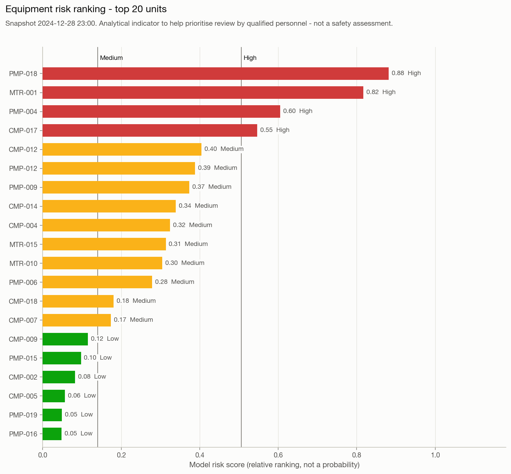

# Business Analysis

> This is a portfolio analysis on **synthetic data**. It shows how predictive-maintenance
> analytics could be structured and what questions it can and cannot answer. It does not report
> measured savings, avoided downtime or any operational outcome, because none were measured - there
> is no real operation behind the data.

## 1. The business question

Rotating equipment - pumps, motors, compressors - keeps an oil and gas facility producing. When a
unit stops unexpectedly, the consequences range from a short process upset to deferred production,
an expensive call-out and sometimes secondary damage. Maintenance teams handle this with a mix of
time-based preventive work, fixed alarm limits and experience.

The question this project asks is narrow and practical:

> *Given the sensor data already being collected, can we produce each day a short, ranked list of
> units whose recent behaviour most resembles the run-up to past failures, with the evidence
> attached, so that qualified people can decide where to look first?*

It deliberately does **not** ask the system to decide whether equipment is failing, whether it is
safe, or what work should be done.

## 2. What the analysis produces

| Output | What it is | Who would use it |
|---|---|---|
| **Risk score per unit** (hourly) | A relative ranking between 0 and 1. Not a probability. | Reliability engineer, planner |
| **Risk category** (Low / Medium / High) | The score compared with two thresholds fixed in advance on historical data. | Planner, operations lead |
| **Sensor-trend note** | Which sensors sit furthest from the unit's own baseline, and whether they are rising or falling. | Whoever goes to look |
| **Suggested review priority** | "Suggest reviewing first", "when scheduling allows", "routine monitoring". | Planner |
| **Back-test and evaluation** | How often the list was right and wrong on held-out data. | Whoever decides whether to trust it |

The ranking table is `reports/tables/risk_ranking.csv`; the chart is
`figures/15_risk_ranking.png`.

### How the categories are defined

| Category | Rule | Behaviour on the simulated test quarter |
|---|---|---|
| **High** | Score at or above 0.506 - the threshold that maximised F1 on the validation period | 2.3% of unit-hours; 46.3% were followed by a failure within 72 h |
| **Medium** | Score at or above 0.140 - the highest threshold that still caught 80% of pre-failure hours on validation | 11.5% of unit-hours; 5.7% were followed by a failure within 72 h |
| **Low** | Everything else | 86.2% of unit-hours; 0.6% were followed by a failure within 72 h |

In the simulated test quarter, a unit-hour in the High category was about 80 times as likely to
be followed by a failure as one in the Low category. Even so, **more than half of High flags were
not followed by a failure within 72 hours.** A High label is a reason to look, not a finding.

## 3. How this could support maintenance work

Each item describes a possible use. None is a claim that the benefit would be realised.

### Inspection prioritisation

On any day most units need no attention. In the test-quarter snapshot, 4 of 60 units were High, 10
Medium, 45 Low and 1 had no current data. A back-test that took the five highest-scoring units
every Monday found that 10 of the 60 units surfaced over twelve weeks had a failure logged within
the following 72 hours - against about 1 expected from picking at random - and those ten covered
10 of the 14 unit-snapshots that were in fact followed by a failure. In other words, a five-unit
weekly list contained most of what was about to happen, alongside a larger number of units where
nothing happened in the window.

### Maintenance planning

Preventive work in the simulation is time-based and blind to condition. A condition-based
indicator could, in principle, inform which scheduled jobs to bring forward and which could wait.
Whether that improves outcomes is an empirical question this project cannot answer: it would need
a controlled comparison on a real fleet.

### Equipment monitoring

Fixed alarm limits treat dissimilar machines alike. The features here are expressed relative to
each unit's own history and adjusted for load and ambient temperature, so "unusual for this
machine under these conditions" is what gets surfaced. On the simulated data, a rule built on the
same unit-relative deviations but without a model reached PR-AUC 0.18; the random forest reached
0.50. The model's contribution is mainly in combining sensors and using trends.

### Operational reporting

The number of units in each category, tracked week by week, is a simple fleet-condition indicator
that can sit beside existing reliability KPIs. The same pipeline also produces a recurring
data-quality report (missing data, sensor dropouts, invalid readings), which is often valuable in
its own right.

### Data-driven decision support

The score comes with its evidence - which sensor, how far from baseline, which direction - and
with a documented error profile. That lets an engineer weigh it against what they already know
instead of being asked to trust a black box.

## 4. The cost of being wrong

No dollar values are used. They do not exist for simulated equipment, and inventing them would
give false precision. The structure of the trade-off is still worth setting out.

| | False positive (flag, no failure) | False negative (failure, no flag) |
|---|---|---|
| Direct cost | Time of a qualified person inspecting a healthy unit | Whatever an unplanned stop costs beyond a planned one |
| Indirect cost | Erosion of trust; a list that is usually wrong stops being read | None beyond today's situation - the failure would have been unplanned anyway - but the tool's credibility suffers |
| What drives it | Inspection effort, travel, access | Criticality, redundancy, repair time, secondary damage |

Two points follow:

1. **The right threshold is a business decision, not a modelling one.** For a critical unit with
   no standby, the Medium threshold (34 of 38 simulated failures flagged, at about 4.8 false-alert
   days per unit per month) may be the better operating point. For redundant, low-consequence
   equipment, High (31 of 38, at about 0.7) or stricter may be. A real deployment would set
   thresholds per equipment class with the people who own those costs.
2. **Alert fatigue is a first-order risk.** At the High threshold, 58% of the unit-days that
   raised an alert were not followed by a failure within 72 hours. If inspections on those days
   routinely find nothing, people stop looking. Analysis of the simulated false alarms shows they
   concentrate on a few persistently degraded units - about half came from three machines - which
   suggests managing alerts per unit (acknowledge, snooze, re-alert on change) rather than
   lowering sensitivity for the whole fleet.

## 5. What the model cannot do

* **It cannot see failures that give no sensor warning.** All three such failures in the
  simulated test quarter were missed, and always will be by a model of this kind.
* **It does not distinguish "degraded" from "about to fail" cleanly.** Every false alarm in the
  simulated test quarter was on a unit the simulator considered genuinely worn. That is useful
  information, but it is not the same as an imminent failure.
* **It does not diagnose.** It reports that vibration is high and rising; it does not say why.
* **It does not assess safety** and must not be used as a substitute for alarm systems,
  protective trips, inspection regimes or engineering judgement.
* **It has not been validated on real equipment.**

## 6. What a real pilot would need

If an operator wanted to test this idea on its own equipment, the honest path would be:

1. **Data audit.** Are sensor histories, work orders and failure records linkable by equipment and
   time? Are failure records reliable? (In practice this is usually the hardest step.)
2. **Retrospective back-test** on historical data with the same leakage controls used here.
3. **Shadow mode.** Run the ranking alongside normal practice for several months without acting
   on it, recording what it would have flagged.
4. **Agreed success measures before starting** - for example failures flagged in advance,
   inspections triggered, findings per inspection - so results cannot be reinterpreted afterwards.
5. **Governance.** Named owners for thresholds, a process for retraining and drift monitoring, and
   a clear statement that the output is advisory.

Only after steps 3 and 4 would it be possible to say anything about downtime or cost.

## 7. Summary for a non-technical reader

* On simulated data, a standard machine-learning model produced a daily ranking that put most
  upcoming failures near the top of the list, typically about two days ahead.
* It was wrong often enough - more than half of its strongest flags - that it only makes sense as
  a prioritisation aid for people, never as an automatic decision-maker.
* Most of its wrong flags were on equipment that was genuinely in poor condition in the
  simulation, just not failing within three days.
* None of this has been tested on real equipment. The value of the project is the method: careful
  data preparation, honest evaluation and clear communication of limits.
