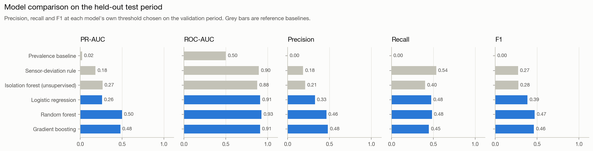
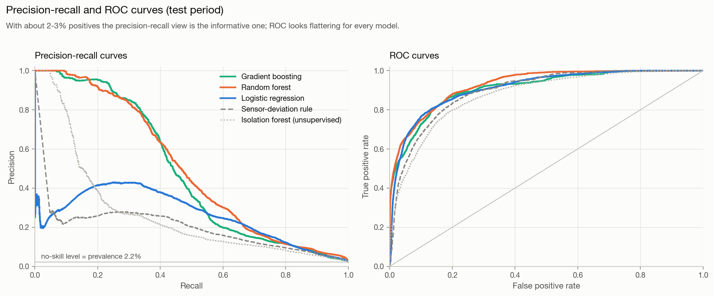
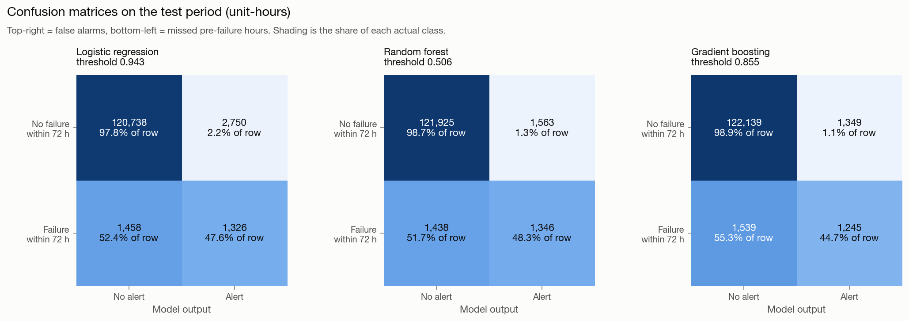
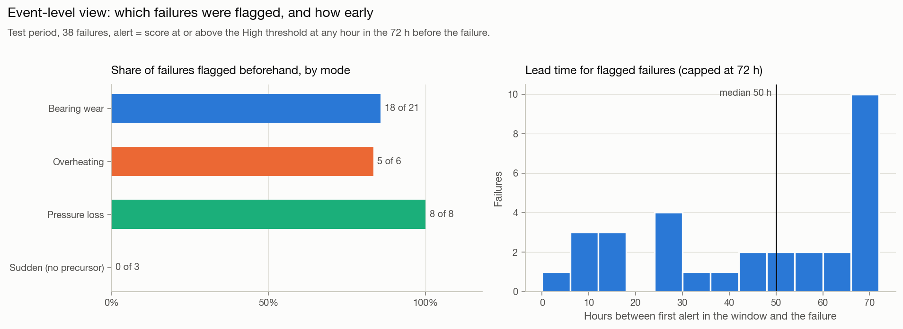
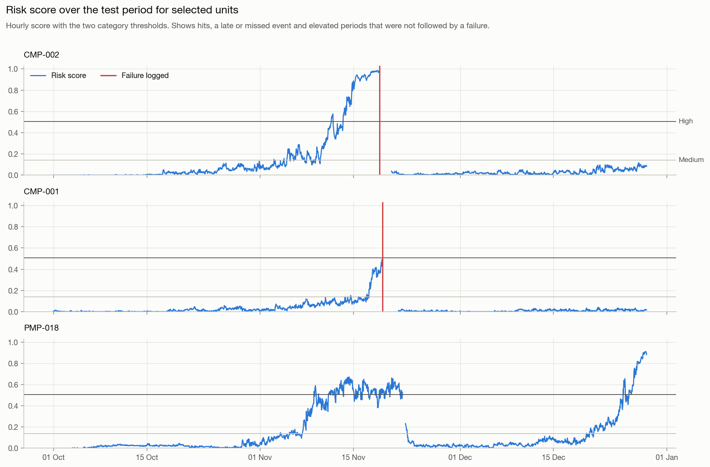
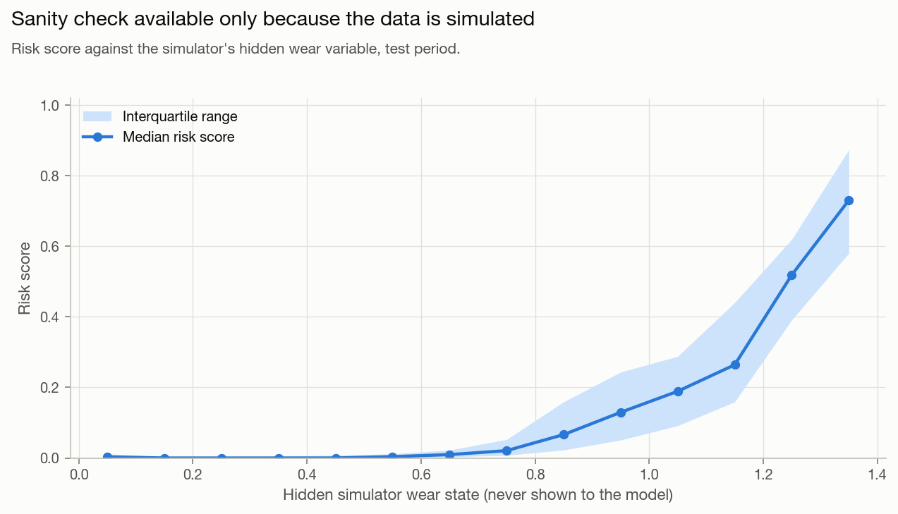
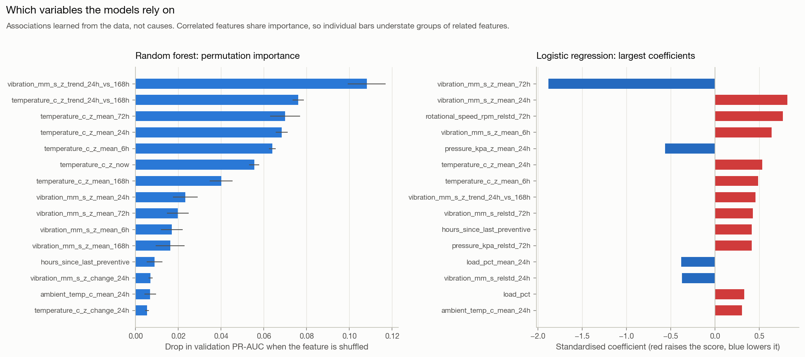
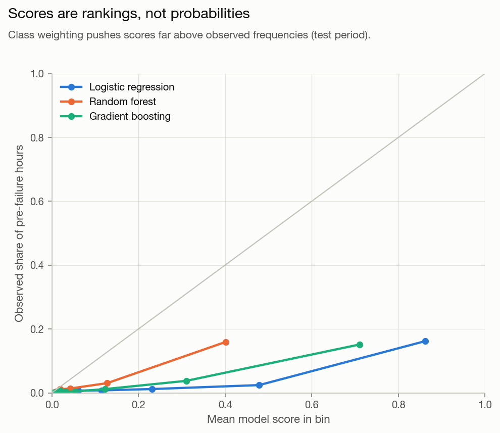

# Model Evaluation Report

> **Scope.** All results are from **synthetic data** produced by this repository's simulator
> (seed 42 unless stated). They describe how the method behaves on that simulator. They are not
> evidence about real equipment and should not be quoted as such. Every number below is copied
> from `reports/metrics.json` or `reports/tables/`, which the pipeline regenerates.

## 1. Summary

* The task is to flag unit-hours that are followed by a logged failure within 72 hours. About
  **2.2%** of unit-hours are positive (1 in 45).
* Walk-forward cross-validation selected the **random forest** as the primary model. On the
  held-out test quarter it reached **PR-AUC 0.50** (95% CI 0.41-0.62) against a no-skill level of
  0.022, and ROC-AUC 0.93.
* At the "High" threshold, **31 of 38 test-period failures (82%)** had at least one alert in the
  preceding 72 hours, with a median lead time of 50 hours, at a cost of about **0.7 false-alert
  days per unit per month**. Fewer than half of flagged unit-hours (46%) were actually followed
  by a failure within 72 hours.
* The three failures with no sensor precursor were all missed, as expected. Among failures that
  had a precursor, 31 of 35 were flagged.
* On three freshly simulated fleets that were never used in development, the same recipe gave
  random-forest PR-AUC between 0.59 and 0.62.
* Logistic regression looked best on the last validation window and worst on the test quarter - a
  useful warning about trusting a single validation period.

## 2. Data and split

| Split | Period | Unit-hours | Positive unit-hours | Positive rate |
|---|---|---|---|---|
| Train | 4 Jan - 28 Jul 2024 | 294,047 | 5,580 | 1.90% |
| Validation | 1 Aug - 27 Sep 2024 | 81,810 | 2,528 | 3.09% |
| Test | 1 Oct - 28 Dec 2024 | 126,272 | 2,784 | 2.20% |

60 units, 153 failures in the year, 47 features. The last 72 hours before each boundary are purged
and the final 72 hours of the record are dropped (outcome not observable).

## 3. Why these metrics

| Metric | What it answers | Why it matters here |
|---|---|---|
| **PR-AUC** (average precision) | Across all thresholds, how well are the rare positives ranked above the negatives? | The headline metric. Its no-skill value equals the positive rate (0.022), so progress is easy to read. |
| **ROC-AUC** | How often does a random positive outrank a random negative? | Reported for completeness. With 98% negatives it is high for every method, including the simple rule (0.90), so it barely separates them. |
| **Precision** | Of the unit-hours flagged, what share preceded a failure? | The cost of a false positive is a qualified person's time on a healthy machine - and, repeated, the credibility of the list. |
| **Recall** | Of the pre-failure unit-hours, what share was flagged? | The cost of a false negative is a failure nobody was pointed towards. |
| **F1** | Balance of the two at one threshold. | Used only as a neutral rule for picking a comparison threshold. |
| **Accuracy** | Share of unit-hours classified correctly. | Reported once to show why it is not used: the baseline that never alerts scores 97.8%, higher than every real model. |
| **Event recall, lead time, false-alert days** | Failures flagged in advance, how early, and how much unnecessary reviewing. | The view a maintenance planner actually works in. |

**On the cost of errors.** No monetary values are attached, because none exist for simulated
equipment. Qualitatively, a missed failure on critical, non-redundant equipment usually costs far
more than an unnecessary inspection, which argues for a lower threshold; on redundant or low-cost
equipment the balance moves the other way. That judgement belongs to the operator, which is why
the system outputs a score and two thresholds rather than a single alarm.

## 4. Model selection (walk-forward, all before the test period)

Mean PR-AUC over three chronological folds (validate on Apr-May, Jun-Jul, Aug-Sep):

| Model | Selected setting | Fold 1 | Fold 2 | Fold 3 | Mean |
|---|---|---|---|---|---|
| Logistic regression | C = 0.01 | 0.444 | 0.466 | 0.610 | 0.506 |
| **Random forest** | min_samples_leaf = 25 | 0.555 | 0.469 | 0.567 | **0.530** |
| Gradient boosting | max_depth = 3, 200 iterations | 0.516 | 0.530 | 0.526 | 0.524 |

The margin between random forest and gradient boosting (0.006) is far smaller than the
fold-to-fold spread. They should be read as equivalent; random forest is simply the one the
pre-declared rule picked. The full grid is in `reports/tables/tuning_walk_forward.csv`.

## 5. Test-period results

Thresholds: each model's maximum-F1 threshold on the validation period, applied unchanged.

| Model | PR-AUC | ROC-AUC | Precision | Recall | F1 | Accuracy | Alert rate |
|---|---|---|---|---|---|---|---|
| Prevalence baseline (never alerts) | 0.022 | 0.500 | - | 0.000 | 0.000 | 0.978 | 0.0% |
| Sensor-deviation rule | 0.184 | 0.896 | 0.184 | 0.536 | 0.273 | 0.937 | 6.4% |
| Isolation forest (unsupervised) | 0.268 | 0.876 | 0.210 | 0.403 | 0.276 | 0.953 | 4.2% |
| Logistic regression | 0.261 | 0.912 | 0.325 | 0.476 | 0.387 | 0.967 | 3.2% |
| **Random forest** | **0.500** | **0.927** | 0.463 | 0.483 | **0.473** | 0.976 | 2.3% |
| Gradient boosting | 0.481 | 0.910 | 0.480 | 0.447 | 0.463 | 0.977 | 2.1% |

**Uncertainty** (cluster bootstrap, resampling whole units, 300 resamples):

| Model | PR-AUC | 95% CI | ROC-AUC | 95% CI |
|---|---|---|---|---|
| Logistic regression | 0.261 | 0.161 - 0.547 | 0.912 | 0.873 - 0.943 |
| Random forest | 0.500 | 0.408 - 0.615 | 0.927 | 0.897 - 0.956 |
| Gradient boosting | 0.481 | 0.362 - 0.594 | 0.910 | 0.865 - 0.947 |

The intervals are wide and overlap. With 38 failures in the test period, the data cannot separate
the two tree models, and the very wide logistic-regression interval shows its result depends on a
few units (section 7).

**Validation to test.** At the High threshold the random forest's precision / recall were
0.60 / 0.57 on validation and 0.46 / 0.48 on test. Some drop is expected when a threshold is tuned
on one period and applied to the next; the test figures are the ones to quote.

## 6. Event-level results (random forest)

| Threshold | Failures flagged | Event recall | Median lead time | Unit-hours flagged | Row precision | Row recall | False-alert days per unit-month |
|---|---|---|---|---|---|---|---|
| High (score ≥ 0.506) | 31 of 38 | 81.6% | 50 h | 2.3% | 46.3% | 48.3% | 0.73 |
| Medium (score ≥ 0.140) | 34 of 38 | 89.5% | 72 h (cap) | 13.8% | 12.4% | 78.0% | 4.82 |

Lead time is measured from the first alert inside the 72-hour window, so it is capped at 72 hours.
Moving from High to Medium flags three more failures and multiplies unnecessary review days by
more than six - the trade-off made concrete.

## 7. Where the model performs well and poorly

### By failure mode (High threshold)

| Failure mode | Failures | Flagged | Pre-failure unit-hours flagged |
|---|---|---|---|
| Pressure loss | 8 | 8 | 70.4% |
| Bearing wear | 21 | 18 | 46.6% |
| Overheating | 6 | 5 | 47.0% |
| Sudden, no precursor | 3 | 0 | 0.0% |

Sudden failures are invisible by construction - the simulator gives them no sensor signature. They
set a ceiling: no model reading these sensors could exceed 35 of 38. Counts per mode are small, so
the differences between modes are indicative only.

### By time to failure

| Hours before failure | Pre-failure unit-hours flagged |
|---|---|
| 0 - 24 | 68.0% |
| 24 - 48 | 47.1% |
| 48 - 72 | 30.0% |

Detection strengthens as failure approaches. Three days out, most pre-failure hours still look
like ordinary degraded operation.

### By equipment type

| Type | PR-AUC | ROC-AUC | Precision | Recall |
|---|---|---|---|---|
| Motor | 0.582 | 0.951 | 0.732 | 0.465 |
| Pump | 0.567 | 0.964 | 0.436 | 0.555 |
| Compressor | 0.449 | 0.893 | 0.374 | 0.448 |

Compressors are the weakest group in this test period. With 20 units per type and a handful of
failures each, this could be chance; it would need more data to call it a real difference.

### False alarms

There were 1,563 false-alarm unit-hours at the High threshold. Because the data is simulated they
can be compared with the simulator's hidden wear state (never available to the model, and never
available at all on real equipment):

| Property of false-alarm unit-hours | Value |
|---|---|
| Hidden wear already in the range where failure hazard is elevated | 100% (versus 32.7% of all non-failure hours) |
| Median hidden wear | 1.24 (versus 0.56 for all non-failure hours) |
| A failure did follow, 3 to 7 days later | 29.6% |
| Came from just three units | 48.1% |

So the false alarms are not noise: every one landed on a unit the simulator considered genuinely
worn, and almost a third were early rather than wrong. The model has learned "this unit is
degraded", which overlaps with, but is not the same as, "this unit fails within 72 hours". That
gap is the main reason precision is below 50%, and it is inherent in the label, not a tuning
problem. It is also concentrated: a few persistently degraded units generate about half of the
false alerts.

This is also what happened to logistic regression. Its score rises roughly linearly with how far
sensors sit from baseline, so it ranked long-running degraded units at the very top. In December
a few such units stayed degraded without failing inside the window, and its precision at the top
of the ranking collapsed (visible on the left of the precision-recall curve). The tree models,
which rely more on recent *trend* features, were less affected.

### Missed failures

Seven of 38 failures had no High alert in the preceding 72 hours: the three sudden failures, three
bearing-wear failures and one overheating failure. Three of the seven did reach the Medium
threshold. The example chart shows a typical late case: the score climbs steeply in the final day
but only touches the High threshold as the unit fails.

### Score versus hidden wear

Spearman correlation between the risk score and the simulator's hidden wear variable on the test
period is 0.69. The score tracks the underlying degradation without ever having seen it.

## 8. Which variables contribute

Permutation importance for the random forest (drop in validation PR-AUC when a feature is
shuffled) is led by the **24-hour-versus-7-day trend of vibration** (0.108) and **of temperature**
(0.076), followed by temperature level features over several windows (0.040 - 0.070) and vibration
level features (0.016 - 0.023). `hours_since_last_preventive` contributes a little (0.009).

Reading this responsibly:

* These are statements about what the model uses, not about what causes failures.
* Correlated features share credit. Shuffling one of four temperature-level windows hurts little
  because the other three remain, so individual bars understate the group.
* Pressure features do not appear near the top even though pressure-loss failures were all
  flagged; in permutation terms their contribution is spread across several correlated windows and
  across a smaller share of events.
* In the logistic model, the large negative coefficient on the 72-hour vibration mean next to
  positive coefficients on the 6- and 24-hour means is the model constructing a trend from levels.
  It does not mean high sustained vibration is protective.

## 9. Robustness checks

### Fresh-seed replication

The frozen recipe (same features, hyper-parameters and threshold rule) on three newly simulated
fleets never used during development:

| Seed | Model | Test failures | PR-AUC | ROC-AUC | Precision | Recall | F1 | Event recall | False-alert days / unit-month |
|---|---|---|---|---|---|---|---|---|---|
| 7 | Logistic regression | 40 | 0.604 | 0.957 | 0.440 | 0.696 | 0.539 | 95.0% | 1.07 |
| 7 | Random forest | 40 | 0.621 | 0.957 | 0.680 | 0.522 | 0.590 | 92.5% | 0.36 |
| 7 | Gradient boosting | 40 | 0.607 | 0.957 | 0.614 | 0.548 | 0.579 | 90.0% | 0.51 |
| 2025 | Logistic regression | 45 | 0.536 | 0.931 | 0.614 | 0.448 | 0.518 | 91.1% | 0.42 |
| 2025 | Random forest | 45 | 0.618 | 0.936 | 0.700 | 0.555 | 0.619 | 86.7% | 0.42 |
| 2025 | Gradient boosting | 45 | 0.552 | 0.924 | 0.668 | 0.428 | 0.522 | 84.4% | 0.43 |
| 31337 | Logistic regression | 45 | 0.419 | 0.911 | 0.429 | 0.418 | 0.423 | 77.8% | 0.67 |
| 31337 | Random forest | 45 | 0.591 | 0.923 | 0.530 | 0.613 | 0.568 | 82.2% | 0.86 |
| 31337 | Gradient boosting | 45 | 0.606 | 0.916 | 0.624 | 0.565 | 0.593 | 84.4% | 0.60 |

| Model | PR-AUC mean (min - max) | Event recall mean (min - max) |
|---|---|---|
| Random forest | 0.610 (0.591 - 0.621) | 87.1% (82.2% - 92.5%) |
| Gradient boosting | 0.588 (0.552 - 0.607) | 86.3% (84.4% - 90.0%) |
| Logistic regression | 0.519 (0.419 - 0.604) | 88.0% (77.8% - 95.0%) |

Two things follow. First, the development seed's test quarter (PR-AUC 0.50) was harder than these
three, so the headline figure does not appear to be flattered by development choices. Second,
random forest is the most stable of the three and logistic regression the least, in line with the
development run.

### Equipment-grouped cross-validation

Five folds over the pre-test period, each unit scored only by a model that never saw it:

| Model | PR-AUC mean ± SD | Range |
|---|---|---|
| Logistic regression | 0.549 ± 0.088 | 0.415 - 0.631 |
| Random forest | 0.559 ± 0.078 | 0.424 - 0.643 |
| Gradient boosting | 0.515 ± 0.082 | 0.405 - 0.604 |

Scores on unseen units are in the same range as the walk-forward scores, so the models are not
depending on having seen a particular machine before. (Grouped folds mix time periods, so this is
a check on unit transfer, not a forecast-quality estimate.)

### Ablation: adding absolute sensor levels

| Model | Validation PR-AUC: unit-normalised → plus absolute | Test PR-AUC: unit-normalised → plus absolute |
|---|---|---|
| Logistic regression | 0.610 → 0.616 | 0.261 → 0.272 |
| Random forest | 0.567 → 0.574 | 0.500 → 0.454 |
| Gradient boosting | 0.526 → 0.573 | 0.481 → 0.463 |

Absolute levels look slightly helpful on validation and are worse on test for both tree models.
On one split this is suggestive rather than conclusive, but there is no evidence they help, and
they add 16 unit-identifying features. They stay out.

### Calibration

Class weighting pushes scores well above observed frequencies. Scores are rankings, not
probabilities, and are never described as "chance of failure".

## 10. Limitations

1. **Synthetic data.** The single most important limitation. Nothing here demonstrates
   performance on real equipment.
2. **The simulator is simple.** Three degradation modes with clean signatures, instant sensor
   response, no sensor drift or recalibration, no changes in operating mode, a tidy maintenance
   log. Real data would be harder on every count.
3. **Inflated failure frequency.** About 2.5 failures per unit-year, chosen to give enough events.
   Real fleets fail far less often, which makes learning harder and precision lower at any given
   recall.
4. **Few events.** 38 failures in the test period. One failure is 2.6 percentage points of event
   recall. Per-mode and per-type figures rest on single-digit counts.
5. **Development contamination.** Test-period scores were inspected while debugging the feature
   pipeline (the ambient-temperature confounding described in
   `documentation/methodology_decisions.md`). The fresh-seed replication is the uncontaminated
   estimate; it came out higher than the development test figure, not lower.
6. **Simulator knowledge.** The modeller wrote the simulator, so feature design was informed by
   how the data was generated. Replication cannot correct for that.
7. **Label definition.** "Fails within 72 hours" treats a unit that fails in 80 hours as a
   negative. A meaningful share of "false alarms" are early alarms.
8. **One year, one fleet.** No test of behaviour across years, fleet changes or new equipment
   types. New units need 72 hours of history before they can be scored.
9. **Uncalibrated scores**; thresholds would need to be reset on any new data.
10. **A small leak in model selection only**: the condition-adjustment coefficients were fitted on
    the full training period, which includes the validation months of the first two walk-forward
    folds. No labels are involved and the test period is unaffected.

## 11. Data-quality issues encountered

Summarised from `reports/data_validation_report.md`: 300 duplicated telemetry rows, 370
out-of-range sensor readings (sentinel temperatures, negative pressures, implausible vibration),
about 0.4% missing values per sensor channel plus multi-hour sensor dropouts, 40 rows with an
equipment type contradicting the registry, two units with an hour-meter reset, three duplicated
failure records, and 292 downtime gaps (all explained by logged maintenance). All were injected by
the generator on purpose and all were detected; the report documents the decision taken for each.
